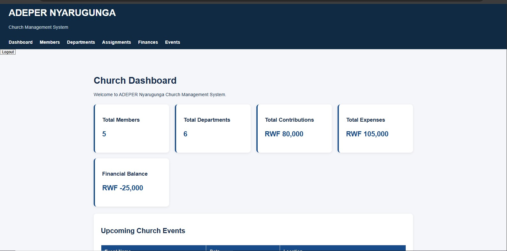

# ADEPER Nyarugunga Church Management System

## Project Overview
The ADEPER Nyarugunga Church Management System is a web-based application designed to help manage church activities and administrative information efficiently.

## Technologies Used
- HTML
- CSS
- JavaScript
- Node.js
- Express.js
- MySQL (TiDB Cloud)
- Git and GitHub

## Main Features
1. **Dashboard** – Displays church statistics and upcoming events.
2. **Members Management** – Register, view, edit, and delete church members.
3. **Departments Management** – Manage church departments.
4. **Assignments Management** – Manage church assignments.
5. **Finance Management** – Record contributions and expenses.
6. **Events Management** – Add, edit, view, and delete church events.
7. **Login System** – Provides user authentication and session management.

## Installation and Setup

### 1. Clone the repository
```bash
git clone YOUR_GITHUB_REPOSITORY_URL
```

### 2. Open the project folder
```bash
cd adeper-church-system
```

### 3. Install dependencies
```bash
npm install
```

### 4. Configure environment variables
Create a `.env` file and add your own database credentials and session secret.

Required variables:
- DB_HOST
- DB_USER
- DB_PASSWORD
- DB_NAME
- DB_PORT
- SESSION_SECRET

### 5. Start the application
```bash
node server.js
```

### 6. Open in your browser
http://localhost:3000

## Project Purpose
This project was developed to support the management of church members, departments, assignments, finances, and events.

## Author
Chante Dufitimana


## Application Screenshots

### Dashboard

